<div align="center">

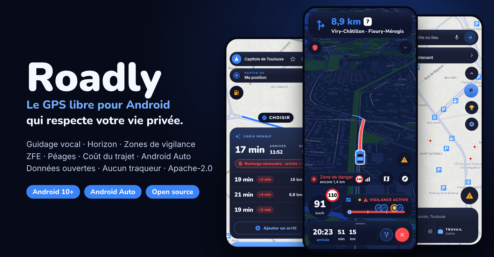

# Roadly

**Le GPS libre pour Android qui respecte votre vie privée.**

Guidage vocal, route à venir, zones de vigilance, ZFE, coût du trajet, Android Auto.<br>
Données publiques et ouvertes. Aucun compte obligatoire. Aucun traqueur.

[](https://github.com/Gomze31/roadly/releases/latest)
[](LICENSE)
[](#installer)
[](#android-auto)

[](https://github.com/Gomze31/roadly/actions/workflows/ci.yml)

[Captures](#captures) · [Fonctions](#ce-que-roadly-sait-faire) · [Installer](#installer) · [Compiler](#compiler) · [Documentation](#documentation) · [Contribuer](#contribuer)

</div>

---

## Pourquoi Roadly ?

La plupart des GPS gratuits se paient avec vos trajets. Roadly fait l'inverse : votre position sert à vous guider, et c'est tout.

- 🔒 **Vos trajets restent chez vous.** Favoris, historique et véhicule sont stockés sur le téléphone. Pas de compte obligatoire, pas de publicité, aucun outil d'analyse.
- 🗺️ **Des sources ouvertes et vérifiables.** OpenStreetMap, Base Adresse Nationale, données publiques de l'État pour les zones de vigilance, les ZFE et le prix des carburants. Roadly n'invente rien : sans donnée, l'écran le dit.
- 🚗 **Pensé pour la conduite.** Gros chiffres, panneaux bleu nuit lisibles de jour comme de nuit, annonces vocales à la bonne distance, Android Auto.
- 💙 **Ouvert.** Code sous licence Apache 2.0 : vous pouvez le lire, le compiler, l'améliorer. Une seule bibliothèque n'est pas libre : celle de Google pour la position ([détail](THIRD_PARTY_LICENSES.md)).

## Ce que Roadly sait faire

<table>
<tr>
<td width="25%">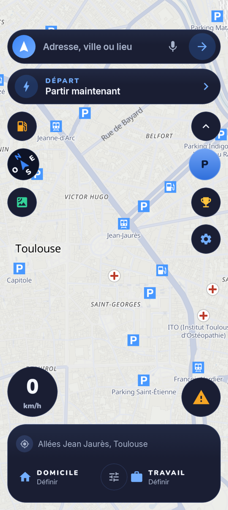</td>
<td width="25%">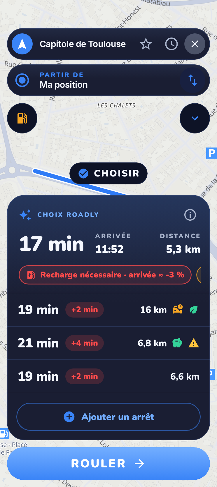</td>
<td width="25%">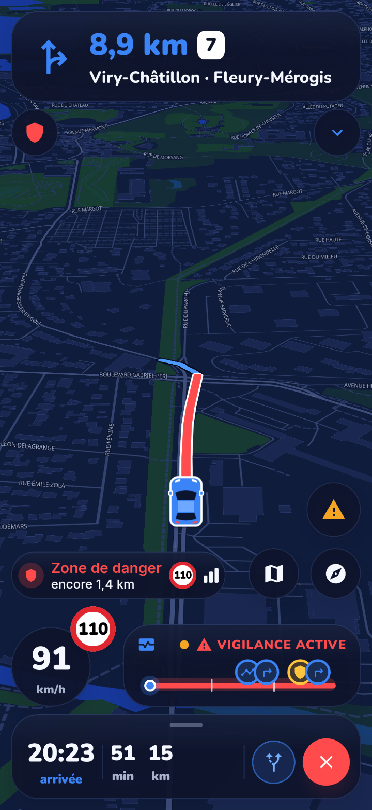</td>
<td width="25%">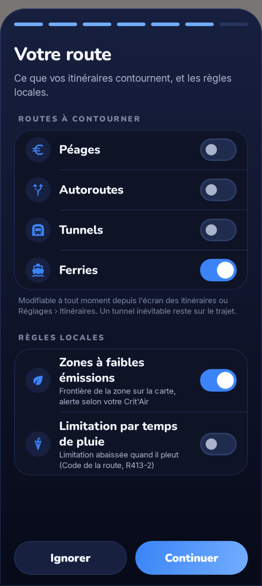</td>
</tr>
<tr>
<td align="center"><b>Accueil</b><br><sub>Départ planifié, stations, parkings, boussole</sub></td>
<td align="center"><b>Choix Roadly</b><br><sub>3 itinéraires, écart de durée, ZFE</sub></td>
<td align="center"><b>Guidage</b><br><sub>Bandeau, limitation, Horizon, vigilance</sub></td>
<td align="center"><b>Votre route</b><br><sub>Péages, autoroutes, tunnels, ferries</sub></td>
</tr>
</table>

## Captures

### Le guidage, de nuit comme de jour

<table>
<tr>
<td width="25%">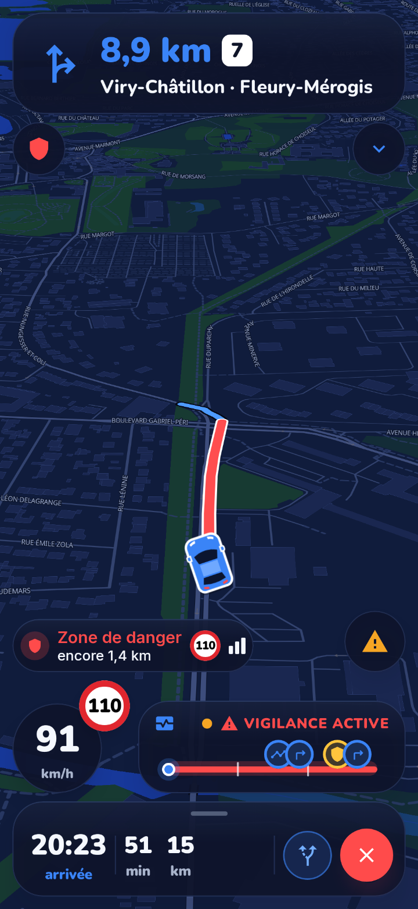</td>
<td width="25%">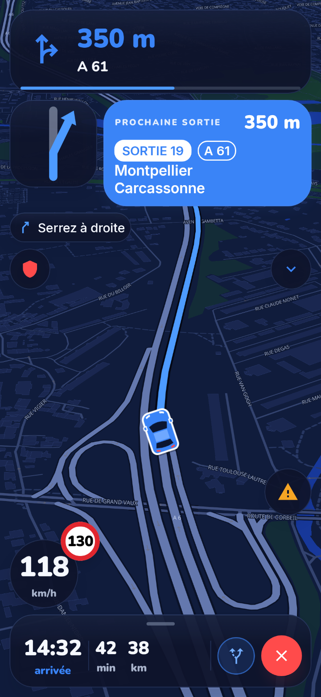</td>
<td width="25%">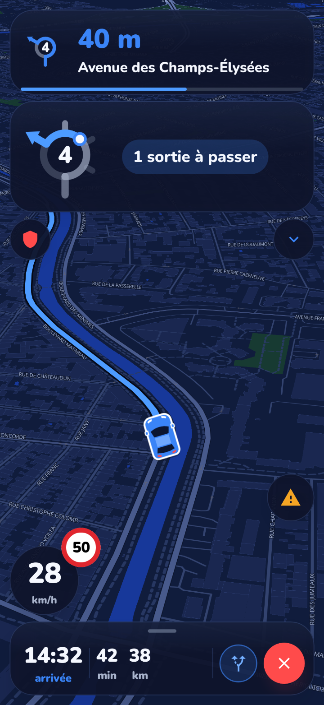</td>
<td width="25%">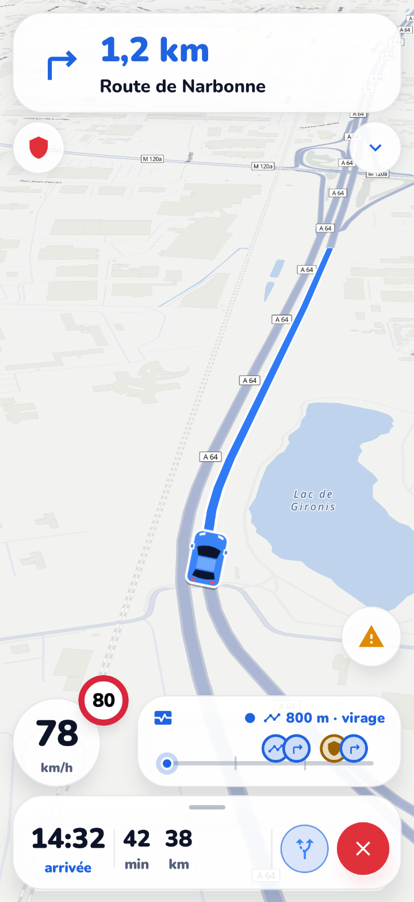</td>
</tr>
<tr>
<td align="center"><b>Vigilance active</b><br><sub>Zone de danger en rouge sur le tracé et dans l'Horizon</sub></td>
<td align="center"><b>Sortie d'autoroute</b><br><sub>Panneau, bifurcation, « Serrez à droite »</sub></td>
<td align="center"><b>Rond-point</b><br><sub>Sortie à prendre, sorties à passer</sub></td>
<td align="center"><b>De jour</b><br><sub>La même interface sur la carte claire</sub></td>
</tr>
</table>

### Premier lancement

<table>
<tr>
<td width="25%">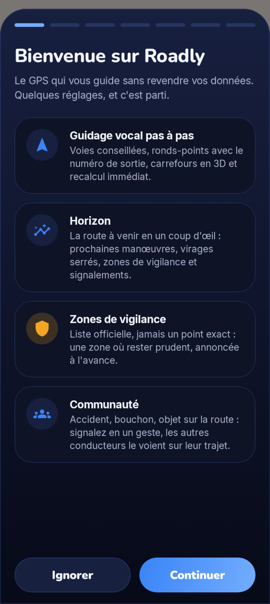</td>
<td width="25%">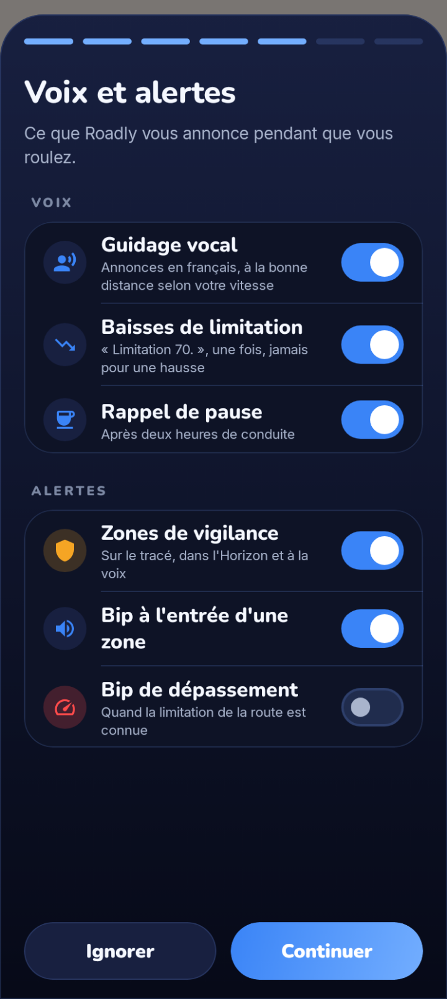</td>
<td width="25%">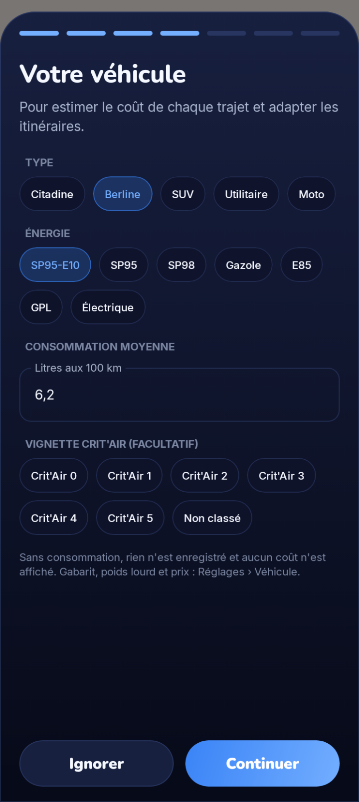</td>
<td width="25%"></td>
</tr>
<tr>
<td align="center"><b>Bienvenue</b><br><sub>Ce que fait Roadly, sans compte</sub></td>
<td align="center"><b>Voix et alertes</b><br><sub>Chaque annonce se règle</sub></td>
<td align="center"><b>Votre véhicule</b><br><sub>Énergie, consommation, Crit'Air</sub></td>
<td align="center"><b>Votre route</b><br><sub>Péages, autoroutes, tunnels, ferries</sub></td>
</tr>
</table>

<sub>Ces images sont des montages d'illustration, pas des captures de téléphone : l'interface est celle de l'application, rendue pendant les tests, posée sur un rendu des cartes Roadly avec les tuiles OpenStreetMap. Comment les refaire : [`tools/readme-images`](tools/readme-images/README.md).</sub>

## Fonctions en détail

### 🧭 Guidage
- Guidage vocal en français, annonces calées sur votre vitesse, « puis… » quand deux manœuvres s'enchaînent.
- Voies conseillées, ronds-points avec le numéro de sortie, panneaux de sortie d'autoroute, **vue 3D des carrefours**.
- **Horizon** : la route à venir en un coup d'œil (manœuvres, virages serrés, zones de vigilance, signalements).
- Limitation de vitesse de la route (OpenStreetMap) et alerte de dépassement, annonce des baisses de limitation, limitation abaissée par temps de pluie.
- **Voix « moins bavarde »** au choix : seulement l'essentiel (manœuvres proches, sécurité).
- **Repères « au feu »** : « Au feu, tournez à droite… » quand le carrefour a des feux (OpenStreetMap), avec un badge sur le bandeau.
- **Virages serrés et ralentisseurs annoncés** (« Attention, virage serré à gauche », « Attention, ralentisseurs »), d'après OpenStreetMap ; désactivables dans les réglages.
- **Péage annoncé** à l'approche (« Péage dans 1 kilomètre, préparez votre moyen de paiement »), feux tricolores dans l'Horizon.
- **Alertes de zones de danger coupées ou rétablies d'un geste** pendant le guidage ; « Vigilance active » dans l'Horizon pendant la traversée d'une zone.
- Recalcul immédiat hors itinéraire, extrapolation dans les tunnels, carte 3D avec bâtiments.
- **Vue photos aériennes (IGN)** : la carte réaliste, avec les vraies photos de l'IGN sous les routes et le tracé, assombries la nuit ; un bouton sur l'accueil, sans clé ni compte.

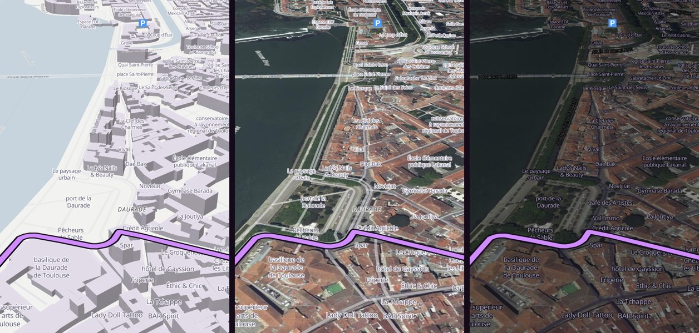
<sub>Plan, photos aériennes de jour, puis de nuit (Toulouse, rendu MapLibre). Photos aériennes © IGN – Géoplateforme (Licence Ouverte), données © contributeurs OpenStreetMap.</sub>

- **Incidents officiels Bison Futé** sur votre trajet (accident, bouchon et sa longueur, véhicule en panne, route fermée, travaux), dans le sens où vous roulez : pastille « Incident détecté », Horizon, carte, Android Auto. Les **routes fermées sont contournées automatiquement**, au calcul comme au recalcul.
- **Image dans l'image** : quittez l'app, la prochaine manœuvre reste visible dans une petite fenêtre.
- Envoyez votre heure d'arrivée en un geste.
- **Appeler un proche** depuis le guidage : jusqu'à quatre proches choisis dans vos contacts ; le téléphone passe l'appel, le guidage continue dans sa petite fenêtre. Sans serveur, sans compte, sans accès à votre carnet d'adresses.

### 🛣️ Itinéraires
- **Voiture électrique** : batterie estimée à l'arrivée selon votre consommation et la vitesse de chaque tronçon ; sous 10 %, Roadly propose les **bornes rapides du trajet** (base nationale IRVE : puissance, prises, tarif, points hors service).
- **Le plus économe** : consommation estimée selon la vitesse de chaque tronçon, badge et litres économisés quand une variante consomme au moins 5 % de moins que la plus rapide.
- Jusqu'à trois variantes distinctes (rapide, court, sans péage) avec l'**écart de durée**, l'heure d'arrivée et la distance ; les tracés identiques sont fusionnés.
- Éviter **péages, autoroutes, tunnels, ferries, chemins non revêtus** sur toutes les variantes, choisis **dès la recherche** pour ce trajet seulement ou mémorisés ; les options actives restent affichées sur le choix d'itinéraire.
- Bouton **« Y aller »** sur chaque résultat de recherche, recherche vocale.
- **Partir à** / **arriver à** une heure donnée, inversion départ ↔ arrivée.
- Jusqu'à **10 arrêts**, réordonnables, avec optimisation de l'ordre (mode tournée).
- **Coût carburant** du trajet selon votre véhicule ; gabarit poids lourd (hauteur, largeur, poids) ; moto, taxi.

### 🌿 Règles locales
- **Zones à faibles émissions (ZFE)** : la base nationale officielle croisée avec votre vignette **Crit'Air**, la date et les horaires. Le choix d'itinéraire indique « ZFE interdite », « certaines heures » ou « autorisée », trace la frontière de la zone sur la carte et donne le lien vers l'arrêté.
- **Zones de vigilance** issues de la liste officielle des équipements, montrées comme des zones de prudence et jamais comme un point exact.
- **Péages en flux libre** : rappel de paiement après le passage.

### ⛽ Autour de vous
- **Stations-service avec les prix officiels** (flux de l'État, mis à jour en continu), tri par prix ou par distance.
- **Bornes rapides sur votre trajet** (50 kW et plus, base nationale des points de recharge) pendant le guidage pour une voiture électrique, avec le dernier état publié (hors service, libres si le relevé est récent).
- **Les stations les moins chères sur votre trajet**, pendant le guidage : à moins de 1,5 km de la route sur les 80 prochains km, avec le détour ; un appui en fait un arrêt.
- Bornes de recharge, parkings, aires de repos à proximité.
- **Voiture garée** mémorisée à l'arrivée, avec le trajet à pied pour la retrouver.

### 👥 Communauté (facultatif)
- Signalements en un geste (accident, bouchon, obstacle, route fermée, travaux, nid-de-poule…), visibles sur la carte et dans l'Horizon des autres conducteurs.
- Points et **classement** : 2 points par signalement, 1 de plus à chaque confirmation.
- Le service communautaire est auto-hébergeable (schéma fourni pour Supabase, voir [`docs/BACKEND.md`](docs/BACKEND.md)). Sans lui, tout le reste fonctionne.

### 🧳 Et aussi
- **Conduite libre** : compteur, limitation et zones de vigilance sans itinéraire.
- **Historique et Replay** de vos trajets (restent sur le téléphone).
- **Mode trottinette électrique** : itinéraires adaptés aux pistes, autonomie estimée.
- **Commandes vocales** : « Rentrer à la maison », « Évite les péages », « Signale un accident », « À quelle heure j'arrive ? »… Sans compte ni clé, rien n'est envoyé à un service d'IA.
- Widget, raccourcis, ouverture des liens `geo:` et des demandes « Naviguer vers… ».
- **Mises à jour intégrées** depuis les releases GitHub, vérifiées par empreinte.

Comment Roadly se situe face à Waze, Google Maps, Coyote et Organic Maps : [`docs/COMPARATIF.md`](docs/COMPARATIF.md).

## Android Auto

Roadly s'affiche sur l'écran de la voiture : recherche, favoris, choix de l'itinéraire, guidage pas à pas, conduite libre, vitesse et limitation sur la carte, alertes de zones et ZFE, **photos aériennes IGN** (bouton sur l'accueil).

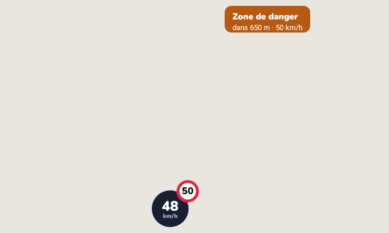

Détails et dépannage : [`docs/ANDROID-AUTO.md`](docs/ANDROID-AUTO.md).

## État du projet

Roadly est en développement actif, avant sa version 1.0. À savoir avant de s'en servir :

- **Le guidage n'a pas encore été validé sur route dans son état actuel.** Les règles de guidage sont couvertes par plus de 1 400 tests automatiques, mais plusieurs comportements récents (reprise après arrêt de l'application, précision dégradée, mise à jour intégrée, sauvegarde) n'ont été vérifiés que sur ordinateur. Gardez les yeux sur la route et sur la signalisation.
- **Les services en ligne sont publics et sans garantie** : itinéraires, recherche et carte dépendent de serveurs tiers gratuits, qui peuvent ralentir ou refuser. Voir [`docs/SERVICES.md`](docs/SERVICES.md).
- **France uniquement** pour les adresses, les ZFE, les prix des carburants et les incidents.
- **Services Google Play requis** pour la position : pas de version pour les téléphones sans services Google.
- Pas de cartes hors ligne, pas d'info trafic en temps réel hors incidents officiels.

L'état de chaque fonction est suivi dans [`FEATURES.md`](FEATURES.md).

## Installer

1. Téléchargez le fichier `roadly-x.y.z.apk` de la **[dernière version](https://github.com/Gomze31/roadly/releases/latest)** depuis votre téléphone. C'est la seule source officielle.
2. Ouvrez-le et autorisez l'installation depuis cette source si Android le demande.
3. Les versions suivantes arrivent directement dans l'application : **Réglages › Mises à jour**. Chaque mise à jour est vérifiée (serveur, taille, empreinte SHA-256, certificat de signature) avant d'être remise à Android, qui demande votre accord.

Configuration minimale : Android 10. Services Google Play requis pour la localisation.

**Vérifier un téléchargement** : chaque version publie l'empreinte du fichier et celle du certificat de signature. La méthode et le certificat officiel sont dans [`docs/SIGNATURE.md`](docs/SIGNATURE.md). Une version qui ne porte pas ce certificat n'est pas une version officielle de Roadly.

Désinstaller Roadly efface vos favoris et vos trajets : exportez-les d'abord (Réglages › Données › Sauvegarde).

## Compiler

```bash
git clone https://github.com/Gomze31/roadly.git
cd roadly
./gradlew :app:assembleDebug
```

```bash
./gradlew testDebugUnitTest :core:model:test :core:common:test :core:scooter:test :core:radar:test
```

Prérequis : JDK 17+, SDK Android 36, un `local.properties` contenant `sdk.dir=…` (ou la variable `ANDROID_HOME`). Aucune clé d'API n'est nécessaire. Le guide complet (modules, fournisseurs, configuration, auto-hébergement) est dans **[`docs/DEVELOPMENT.md`](docs/DEVELOPMENT.md)**, la vue d'ensemble dans [`ARCHITECTURE.md`](ARCHITECTURE.md).

Votre compilation est signée par votre propre clé : Android ne l'installera pas par-dessus une version officielle, et inversement.

## Documentation

| Pour… | Lisez |
|---|---|
| Savoir ce qui marche, et jusqu'où | [`FEATURES.md`](FEATURES.md), [`docs/ROADMAP.md`](docs/ROADMAP.md) |
| Comprendre le code | [`ARCHITECTURE.md`](ARCHITECTURE.md), [`docs/DEVELOPMENT.md`](docs/DEVELOPMENT.md), [`docs/DESIGN-SYSTEM.md`](docs/DESIGN-SYSTEM.md) |
| Changer de serveur de cartes ou d'itinéraires | [`docs/API-PROVIDERS.md`](docs/API-PROVIDERS.md), [`docs/SERVICES.md`](docs/SERVICES.md) |
| Héberger le service communautaire | [`docs/BACKEND.md`](docs/BACKEND.md) |
| Utiliser Android Auto | [`docs/ANDROID-AUTO.md`](docs/ANDROID-AUTO.md) |
| Vérifier une version ou une mise à jour | [`docs/SIGNATURE.md`](docs/SIGNATURE.md), [`docs/UPDATES.md`](docs/UPDATES.md) |
| Savoir ce qui sort du téléphone | [`PRIVACY.md`](PRIVACY.md), [`SECURITY.md`](SECURITY.md) |
| Suivre l'historique du développement | [`docs/suivi/`](docs/suivi) |

## Sous le capot

| | |
|---|---|
| **Langage et UI** | Kotlin, Jetpack Compose, Material 3, police Nunito et Inter |
| **Architecture** | Modules `core:*` / `feature:*`, MVVM, Hilt, coroutines et Flow |
| **Carte** | MapLibre Android, tuiles OpenFreeMap (OpenStreetMap) |
| **Itinéraires** | Valhalla (FOSSGIS par défaut, auto-hébergeable) |
| **Recherche** | Base Adresse Nationale, Photon |
| **Stockage** | Room, DataStore |
| **Voiture** | Android for Cars App Library |
| **Tests** | 1 400+ tests JVM, rendus d'écran Robolectric, tests instrumentés |

Les adresses des fournisseurs se changent dans **Réglages › Fournisseurs**, par exemple pour pointer vers votre propre Valhalla. Détails : [`docs/API-PROVIDERS.md`](docs/API-PROVIDERS.md).

## Contribuer

Les contributions sont bienvenues : signalement de bug, idée, correction, nouvelle source de données ouverte.

1. Ouvrez une *issue* pour discuter du changement.
2. Créez une branche, ajoutez des tests, vérifiez que `./gradlew testDebugUnitTest` passe.
3. Proposez une *pull request*.

Le guide complet est dans [`CONTRIBUTING.md`](CONTRIBUTING.md), les règles de vie commune dans [`CODE_OF_CONDUCT.md`](CODE_OF_CONDUCT.md). Une contribution fusionnée n'est pas une version publiée : les versions officielles sont signées par le propriétaire du projet.

Une faille de sécurité ? Ne l'ouvrez pas en *issue* publique : voir [`SECURITY.md`](SECURITY.md) (signalement privé et dernier audit).

Ce que Roadly envoie, et à qui : [`PRIVACY.md`](PRIVACY.md).

Une règle guide le projet : **aucune fonction fictive**. Une fonction n'existe que si elle repose sur une source réelle ; sinon, l'interface le dit.

L'état de chaque fonction est suivi dans [`FEATURES.md`](FEATURES.md) et la suite prévue dans [`docs/ROADMAP.md`](docs/ROADMAP.md).

## Données et remerciements

Roadly existe grâce aux données ouvertes et aux projets libres :

- Cartographie © [contributeurs OpenStreetMap](https://www.openstreetmap.org/copyright) (ODbL), tuiles [OpenFreeMap](https://openfreemap.org), rendu [MapLibre](https://maplibre.org) (BSD-2).
- Itinéraires [Valhalla](https://github.com/valhalla/valhalla), serveur public de [FOSSGIS](https://fossgis.de).
- Adresses : [Base Adresse Nationale](https://adresse.data.gouv.fr) (Licence Ouverte 2.0) ; lieux : [Photon](https://photon.komoot.io).
- Incidents de circulation : [Bison Futé](https://www.bison-fute.gouv.fr) (DATEX II, données publiques).
- [Base nationale consolidée des ZFE](https://transport.data.gouv.fr/datasets/base-nationale-consolidee-des-zones-a-faibles-emissions), [prix des carburants](https://data.economie.gouv.fr), liste des équipements de contrôle routier : données publiques sous Licence Ouverte.
- Météo : [Open-Meteo](https://open-meteo.com) (CC BY 4.0).
- Bornes de recharge : [base nationale consolidée des points de recharge](https://transport.data.gouv.fr/datasets/beta-bases-nationales-des-points-de-recharge-pour-vehicules-electriques-en-france-irve) (Point d'Accès National, Licence Ouverte).
- Photos aériennes : [IGN – Géoplateforme](https://geoservices.ign.fr) (orthophotographies, Licence Ouverte 2.0).
- Polices [Nunito](https://github.com/googlefonts/nunito) et [Inter](https://rsms.me/inter/) (SIL Open Font License 1.1).

Les serveurs publics de Valhalla et Photon sont offerts en *fair-use* : pour une diffusion à grande échelle, auto-hébergez-les (voir [`docs/API-PROVIDERS.md`](docs/API-PROVIDERS.md)).

## Licence

Le code de Roadly est distribué sous **[licence Apache 2.0](LICENSE)**. Vous pouvez l'utiliser, l'étudier, le modifier et le redistribuer, en conservant les mentions de [`NOTICE`](NOTICE).

- Les bibliothèques livrées avec l'application et leurs licences : [`THIRD_PARTY_LICENSES.md`](THIRD_PARTY_LICENSES.md). L'une d'elles, la bibliothèque de Google pour la position, n'est pas libre.
- Les données (OpenStreetMap, données publiques) gardent leur propre licence et leur attribution.
- La licence ne couvre ni le nom « Roadly » ni son logo : une version modifiée et redistribuée change de nom, d'icône et d'identifiant d'application.

<div align="center">
<sub>Fait avec 💙 pour tous ceux qui aiment conduire sans être suivis.</sub>
</div>
