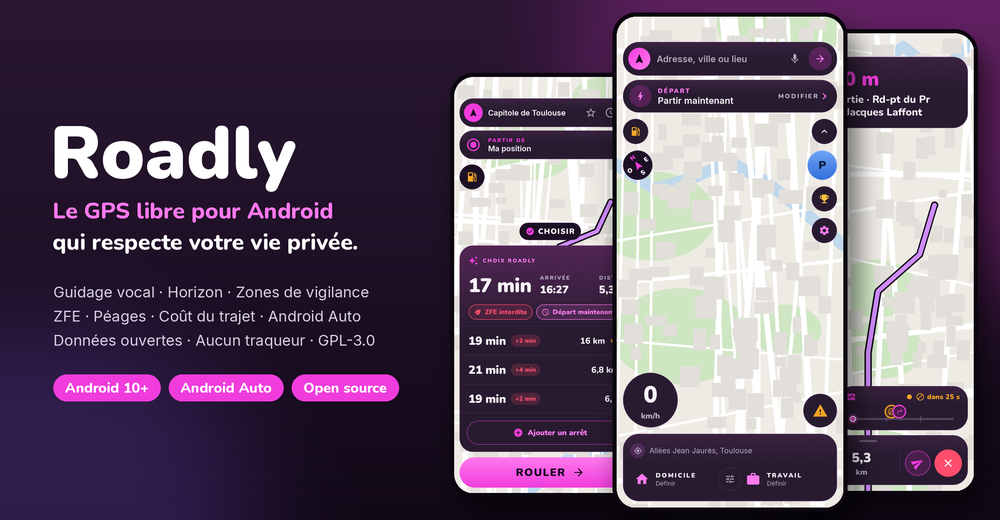
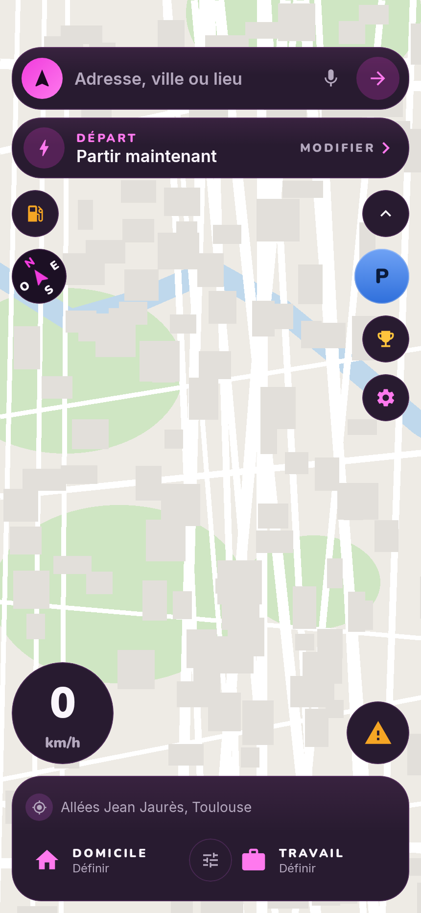
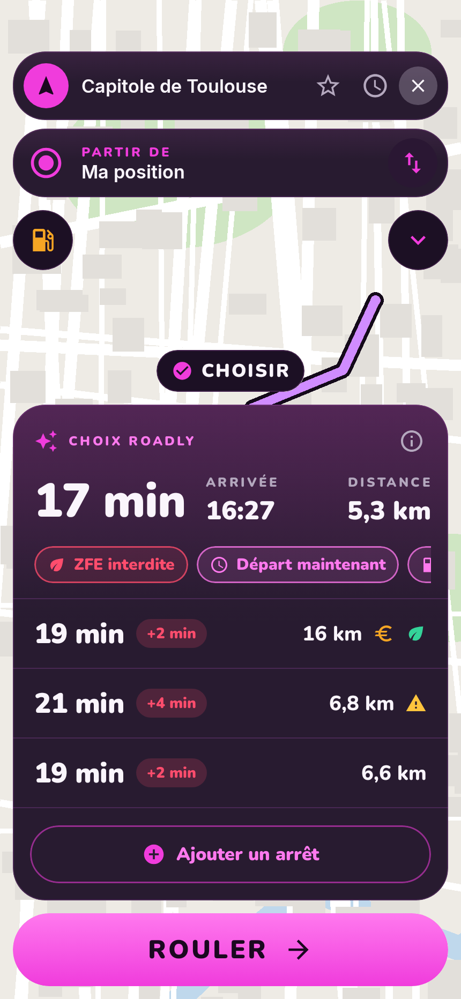
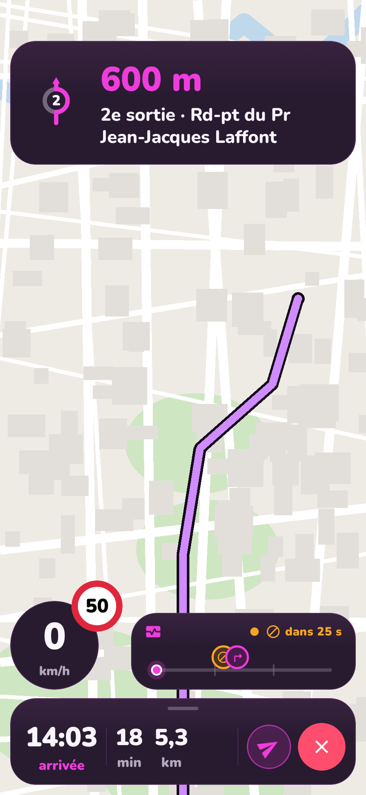
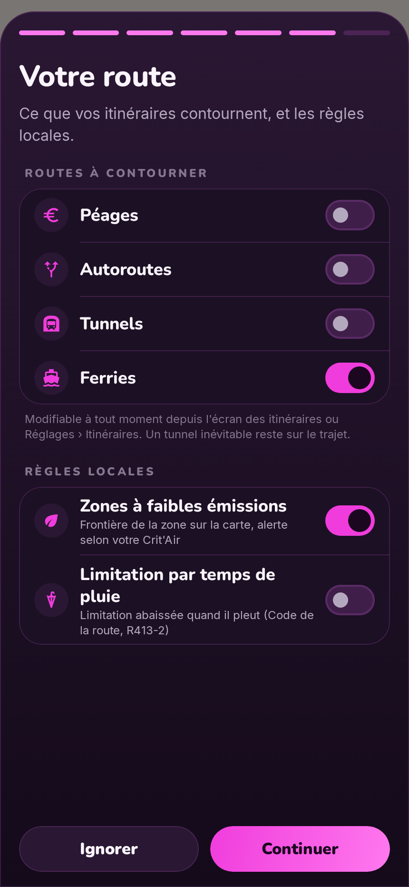
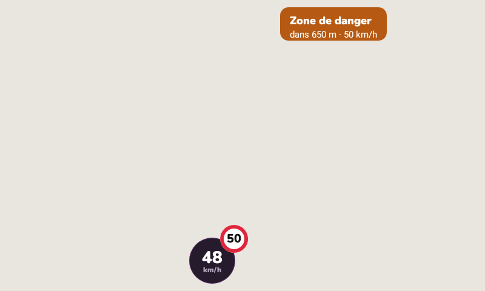

<div align="center">



# Roadly

**Le GPS libre pour Android qui respecte votre vie privée.**

Guidage vocal, route à venir, zones de vigilance, ZFE, coût du trajet, Android Auto.<br>
Données publiques et ouvertes. Aucun compte obligatoire. Aucun traqueur.

[](https://github.com/Gomze31/roadly/releases/latest)
[](LICENSE)
[](#installer)
[](#android-auto)

</div>

---

## Pourquoi Roadly ?

La plupart des GPS gratuits se paient avec vos trajets. Roadly fait l'inverse : votre position sert à vous guider, et c'est tout.

- 🔒 **Vos trajets restent chez vous.** Favoris, historique et véhicule sont stockés sur le téléphone. Pas de compte obligatoire, pas de publicité, aucun outil d'analyse.
- 🗺️ **Des sources ouvertes et vérifiables.** OpenStreetMap, Base Adresse Nationale, données publiques de l'État pour les zones de vigilance, les ZFE et le prix des carburants. Roadly n'invente rien : sans donnée, l'écran le dit.
- 🚗 **Pensé pour la conduite.** Gros chiffres, interface sombre lisible de jour comme de nuit, annonces vocales à la bonne distance, Android Auto.
- 💜 **Libre.** Code sous GPL-3.0 : vous pouvez le lire, le compiler, l'améliorer.

## Ce que Roadly sait faire

<table>
<tr>
<td width="25%"></td>
<td width="25%"></td>
<td width="25%"></td>
<td width="25%"></td>
</tr>
<tr>
<td align="center"><b>Accueil</b><br><sub>Départ planifié, stations, parkings, boussole</sub></td>
<td align="center"><b>Choix Roadly</b><br><sub>3 itinéraires, écart de durée, ZFE</sub></td>
<td align="center"><b>Guidage</b><br><sub>Bandeau, limitation, Horizon</sub></td>
<td align="center"><b>Votre route</b><br><sub>Péages, autoroutes, tunnels, ferries</sub></td>
</tr>
</table>

<sub>Rendus de l'interface générés pendant le développement ; sur le téléphone, la carte est rendue par MapLibre à partir des tuiles OpenStreetMap.</sub>

### 🧭 Guidage
- Guidage vocal en français, annonces calées sur votre vitesse, « puis… » quand deux manœuvres s'enchaînent.
- Voies conseillées, ronds-points avec le numéro de sortie, panneaux de sortie d'autoroute, **vue 3D des carrefours**.
- **Horizon** : la route à venir en un coup d'œil (manœuvres, virages serrés, zones de vigilance, signalements).
- Limitation de vitesse de la route (OpenStreetMap) et alerte de dépassement, annonce des baisses de limitation, limitation abaissée par temps de pluie.
- Recalcul immédiat hors itinéraire, extrapolation dans les tunnels, carte 3D avec bâtiments.
- **Incidents officiels Bison Futé** sur votre trajet (accident, bouchon et sa longueur, véhicule en panne, route fermée, travaux), dans le sens où vous roulez : pastille « Incident détecté », Horizon, carte, Android Auto.
- **Image dans l'image** : quittez l'app, la prochaine manœuvre reste visible dans une petite fenêtre.
- Envoyez votre heure d'arrivée en un geste.

### 🛣️ Itinéraires
- Jusqu'à trois variantes distinctes (rapide, court, sans péage) avec l'**écart de durée**, l'heure d'arrivée et la distance ; les tracés identiques sont fusionnés.
- Éviter **péages, autoroutes, tunnels, ferries, chemins non revêtus** sur toutes les variantes, choisis **dès la recherche** pour ce trajet seulement ou mémorisés ; les options actives restent affichées sur le choix d'itinéraire.
- Bouton **« Y aller »** sur chaque résultat de recherche, recherche vocale.
- **Partir à** / **arriver à** une heure donnée, inversion départ ↔ arrivée.
- Jusqu'à **10 arrêts**, réordonnables, avec optimisation de l'ordre (mode tournée).
- **Coût carburant** du trajet selon votre véhicule ; gabarit poids lourd (hauteur, largeur, poids) ; moto, taxi.

### 🌿 Règles locales
- **Zones à faibles émissions (ZFE)** : la base nationale officielle croisée avec votre vignette **Crit'Air**, la date et les horaires. Le choix d'itinéraire indique « ZFE interdite », « certaines heures » ou « autorisée », trace la frontière de la zone sur la carte et donne le lien vers l'arrêté.
- **Zones de vigilance** issues de la liste officielle des équipements, montrées comme des zones de prudence et jamais comme un point exact.
- **Péages en flux libre** : rappel de paiement après le passage.

### ⛽ Autour de vous
- **Stations-service avec les prix officiels** (flux de l'État, mis à jour en continu), tri par prix ou par distance.
- Bornes de recharge, parkings, aires de repos à proximité.
- **Voiture garée** mémorisée à l'arrivée, avec le trajet à pied pour la retrouver.

### 👥 Communauté (facultatif)
- Signalements en un geste (accident, bouchon, obstacle, route fermée, travaux, nid-de-poule…), visibles sur la carte et dans l'Horizon des autres conducteurs.
- Points et **classement** : 2 points par signalement, 1 de plus à chaque confirmation.
- Le service communautaire est auto-hébergeable (schéma fourni pour Supabase, voir [`docs/BACKEND.md`](docs/BACKEND.md)). Sans lui, tout le reste fonctionne.

### 🧳 Et aussi
- **Conduite libre** : compteur, limitation et zones de vigilance sans itinéraire.
- **Historique et Replay** de vos trajets (restent sur le téléphone).
- **Mode trottinette électrique** : itinéraires adaptés aux pistes, autonomie estimée.
- **Commandes vocales** : « Rentrer à la maison », « Évite les péages », « Signale un accident », « À quelle heure j'arrive ? »… Sans compte ni clé, rien n'est envoyé à un service d'IA.
- Widget, raccourcis, ouverture des liens `geo:` et des demandes « Naviguer vers… ».
- **Mises à jour intégrées** depuis les releases GitHub, vérifiées par empreinte.

Comment Roadly se situe face à Waze, Google Maps, Coyote et Organic Maps : [`docs/COMPARATIF.md`](docs/COMPARATIF.md).

## Android Auto

Roadly s'affiche sur l'écran de la voiture : recherche, favoris, choix de l'itinéraire, guidage pas à pas, conduite libre, vitesse et limitation sur la carte, alertes de zones et ZFE.



Détails et dépannage : [`docs/ANDROID-AUTO.md`](docs/ANDROID-AUTO.md).

## Installer

1. Téléchargez le fichier `roadly-x.y.z.apk` de la **[dernière version](https://github.com/Gomze31/roadly/releases/latest)** depuis votre téléphone.
2. Ouvrez-le et autorisez l'installation depuis cette source si Android le demande.
3. Les versions suivantes arrivent directement dans l'application : **Réglages › Mises à jour**.

Configuration minimale : Android 10. Services Google Play requis pour la localisation.

## Compiler

```bash
git clone https://github.com/Gomze31/roadly.git
cd roadly
./gradlew :app:assembleDebug
```

```bash
./gradlew testDebugUnitTest :core:model:test :core:common:test
```

Prérequis : JDK 17+, SDK Android 36, un `local.properties` contenant `sdk.dir=…`. Aucune clé d'API n'est nécessaire. Le guide complet (modules, fournisseurs, configuration, auto-hébergement) est dans **[`docs/DEVELOPMENT.md`](docs/DEVELOPMENT.md)**.

## Sous le capot

| | |
|---|---|
| **Langage et UI** | Kotlin, Jetpack Compose, Material 3, police Nunito et Inter |
| **Architecture** | Modules `core:*` / `feature:*`, MVVM, Hilt, coroutines et Flow |
| **Carte** | MapLibre Android, tuiles OpenFreeMap (OpenStreetMap) |
| **Itinéraires** | Valhalla (FOSSGIS par défaut, auto-hébergeable) |
| **Recherche** | Base Adresse Nationale, Photon |
| **Stockage** | Room, DataStore |
| **Voiture** | Android for Cars App Library |
| **Tests** | 780+ tests JVM, rendus d'écran Robolectric, tests instrumentés |

Les adresses des fournisseurs se changent dans **Réglages › Fournisseurs**, par exemple pour pointer vers votre propre Valhalla. Détails : [`docs/API-PROVIDERS.md`](docs/API-PROVIDERS.md).

## Contribuer

Les contributions sont bienvenues : signalement de bug, idée, correction, nouvelle source de données ouverte.

1. Ouvrez une *issue* pour discuter du changement.
2. Créez une branche, ajoutez des tests, vérifiez que `./gradlew testDebugUnitTest` passe.
3. Proposez une *pull request*.

Une règle guide le projet : **aucune fonction fictive**. Une fonction n'existe que si elle repose sur une source réelle ; sinon, l'interface le dit.

L'état de chaque fonction est suivi dans [`FEATURES.md`](FEATURES.md) et la suite prévue dans [`docs/ROADMAP.md`](docs/ROADMAP.md).

## Données et remerciements

Roadly existe grâce aux données ouvertes et aux projets libres :

- Cartographie © [contributeurs OpenStreetMap](https://www.openstreetmap.org/copyright) (ODbL), tuiles [OpenFreeMap](https://openfreemap.org), rendu [MapLibre](https://maplibre.org) (BSD-2).
- Itinéraires [Valhalla](https://github.com/valhalla/valhalla), serveur public de [FOSSGIS](https://fossgis.de).
- Adresses : [Base Adresse Nationale](https://adresse.data.gouv.fr) (Licence Ouverte 2.0) ; lieux : [Photon](https://photon.komoot.io).
- Incidents de circulation : [Bison Futé](https://www.bison-fute.gouv.fr) (DATEX II, données publiques).
- [Base nationale consolidée des ZFE](https://transport.data.gouv.fr/datasets/base-nationale-consolidee-des-zones-a-faibles-emissions), [prix des carburants](https://data.economie.gouv.fr), liste des équipements de contrôle routier : données publiques sous Licence Ouverte.
- Météo : [Open-Meteo](https://open-meteo.com) (CC BY 4.0).
- Polices [Nunito](https://github.com/googlefonts/nunito) et [Inter](https://rsms.me/inter/) (SIL Open Font License 1.1).

Les serveurs publics de Valhalla et Photon sont offerts en *fair-use* : pour une diffusion à grande échelle, auto-hébergez-les (voir [`docs/API-PROVIDERS.md`](docs/API-PROVIDERS.md)).

## Licence

Roadly est un logiciel libre distribué sous **[GNU General Public License v3.0](LICENSE)**. Vous pouvez l'utiliser, l'étudier, le modifier et le redistribuer ; toute version modifiée et distribuée doit rester libre sous la même licence.

<div align="center">
<sub>Fait avec 💜 pour tous ceux qui aiment conduire sans être suivis.</sub>
</div>
